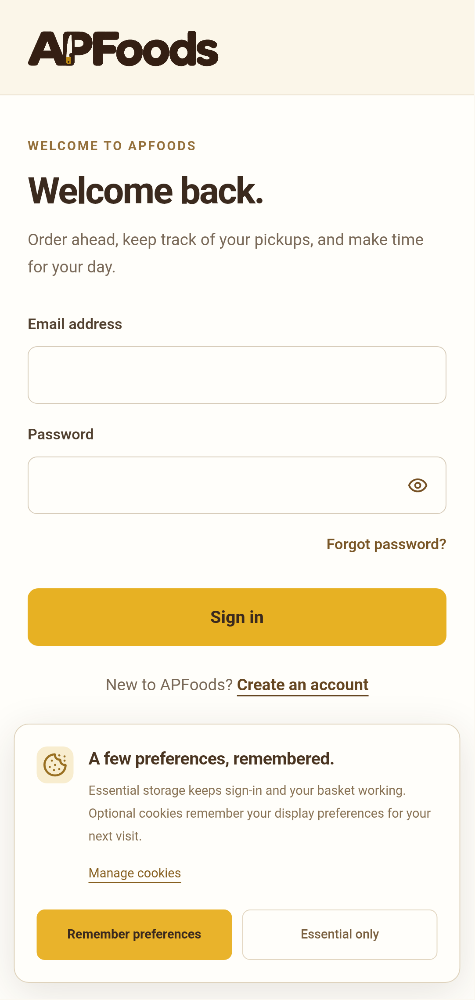
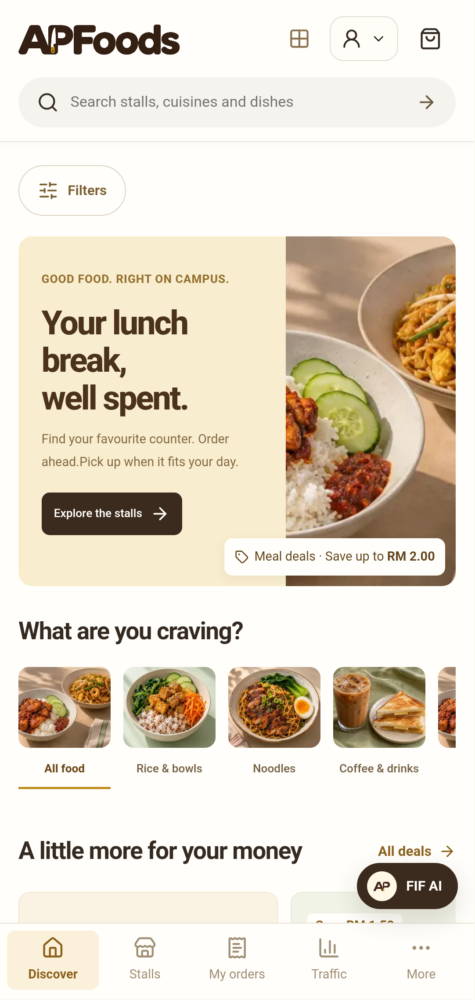
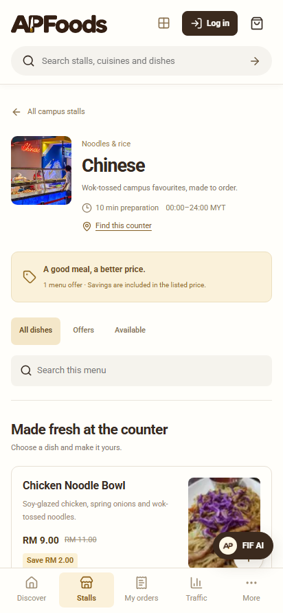
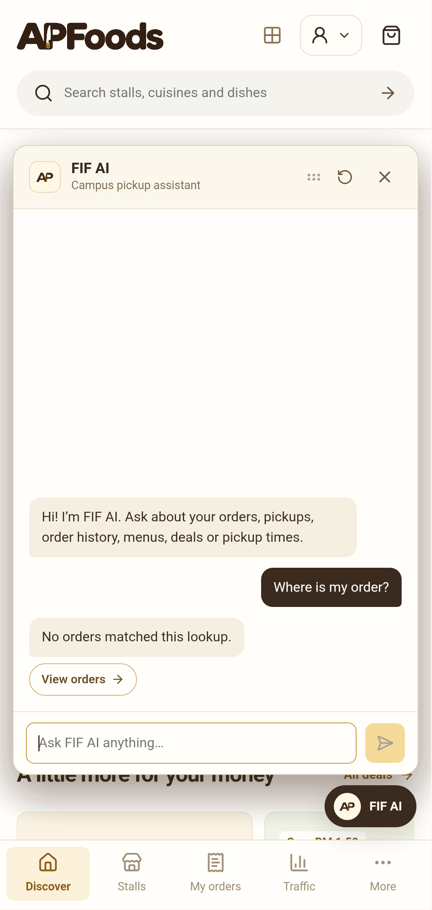
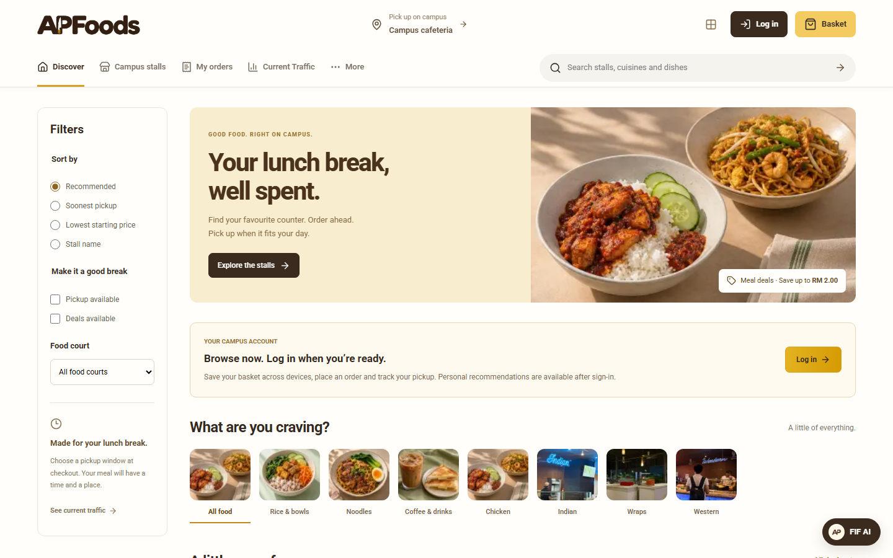
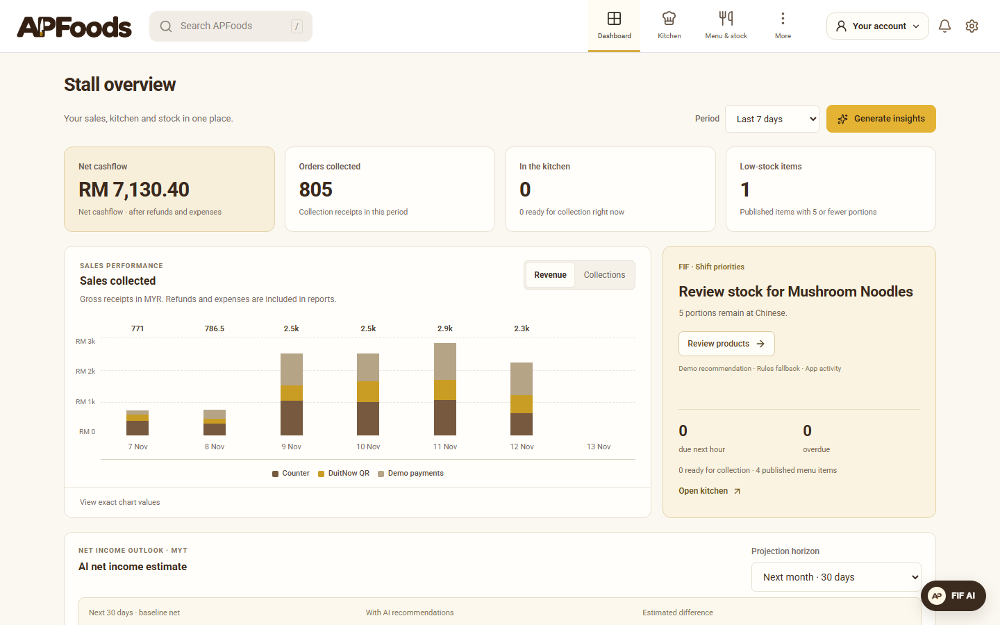
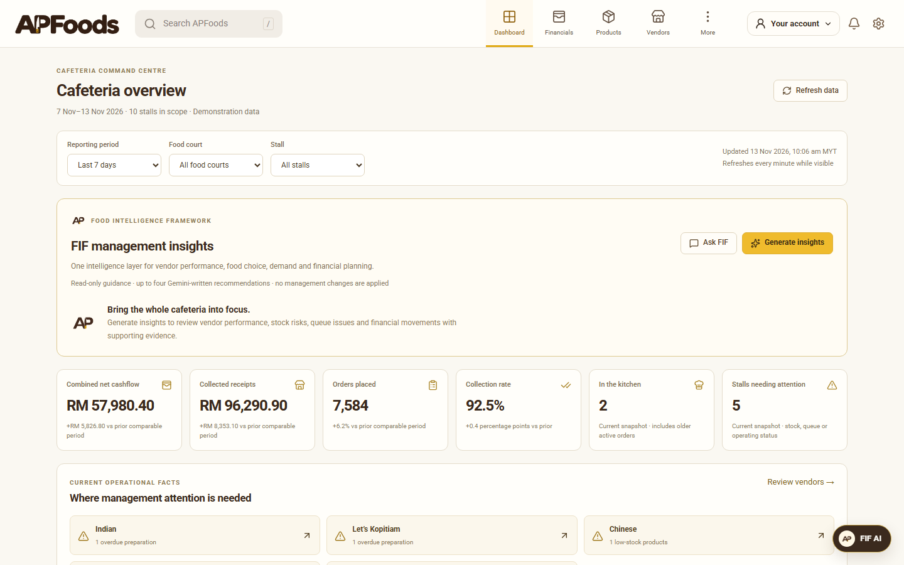

# AP Food + FIF AI

<div align="center">
  
  <br /><br />
  <p><strong>Next-Generation Campus Food-Court Platform & Autonomous Intelligence Suite</strong></p>
  <p>
    Built with <strong>Next.js</strong>, <strong>Capacitor 8</strong>, <strong>Supabase</strong>, and <strong>Google Gemini</strong>.
  </p>

  <p>
    <a href="https://github.com/cloudywalnut/APFood/releases/tag/v1.0.0">
      
    </a>
    &nbsp;
    <a href="https://apfoods.vercel.app">
      
    </a>
    &nbsp;
    
  </p>
</div>

---

## 🌟 Executive Summary

**AP Food** is an enterprise campus dining and kitchen operations ecosystem engineered for Asia Pacific University (APU). It eliminates physical cafeteria queue bottlenecks through synchronized multi-stall pre-ordering, scheduled break pickups, real-time bump-bar dispatch, and **FIF AI** (_Food Intelligence Framework_) — an autonomous copilot suite for students, food vendors, and cafeteria administrators.

The platform provides two purpose-built runtime environments:

1. **The Standalone Android Mobile App (Student Edition)**: A native Capacitor 8 Android client built exclusively for students, optimized for rapid discovery, scheduled pickup slots, and conversational AI ordering.
2. **The Multi-Portal Desktop Web Platform**: High-throughput operational suites for **Food-Stall Vendors** (kitchen dispatch board, live capacity controls, inventory telemetry) and **Cafeteria Administrators** (financial audit, rush prediction, tenant oversight).

---

## 📱 Standalone Android App (Student Experience)

The mobile client is packaged as a standalone Android APK and dedicated exclusively to the student journey. Non-student accounts are automatically gated to the desktop web portal to keep mobile response times sub-second and distraction-free.

<div align="center">
  <p><strong>The End-to-End Student Mobile Flow</strong></p>
  <table border="0">
    <tr>
      <td align="center" width="25%">
        
        <br />
        <sub><b>1. Authentication</b><br />Session & cookie persistence</sub>
      </td>
      <td align="center" width="25%">
        
        <br />
        <sub><b>2. Marketplace</b><br />Cuisine filters & campus deals</sub>
      </td>
      <td align="center" width="25%">
        
        <br />
        <sub><b>3. Counter Menu</b><br />Live pricing, prep times & stock</sub>
      </td>
      <td align="center" width="25%">
        
        <br />
        <sub><b>4. FIF AI Assistant</b><br />Real-time order lookup & advice</sub>
      </td>
    </tr>
  </table>
</div>

### Student Core Highlights

- **Multi-Stall Cart**: Pool dishes from different counters (e.g. Chinese noodle bar + Malay drinks) into one unified checkout.
- **Scheduled Break Pickups**: Reserve meals ahead with selectable pickup time slots matched to lecture breaks.
- **Visual Order Progression**: 4-stage tracking (_Placed &rarr; Accepted &rarr; Preparing &rarr; Ready_) with cryptographic 8-digit pickup codes and QR verification.

---

## 💻 Web Multi-Portal Ecosystem

Optimized for widescreen desktop displays, the web platform powers the commercial, logistical, and managerial operations of the food court.

### 1. Student Web Marketplace

Interactive full-viewport discovery interface featuring real-time counter operating hours, dish imagery, cuisine classifications, and promotion badges.

<div align="center">
  
</div>

---

### 2. Vendor Kitchen Board & Operations Centre

High-density kitchen workstation for stall operators featuring an audible live bump-bar queue, preparation velocity controls, real-time inventory depletion tracking, and revenue charts.

<div align="center">
  
</div>

---

### 3. Cafeteria Administrator Command Centre

Executive operational desk reconciling multi-vendor ledger transactions, collection rates, queue density heatmaps, and automated PDF/CSV financial audit reports.

<div align="center">
  
</div>

---

## 🧠 FIF AI: Autonomous Intelligence Framework

The **Food Intelligence Framework (FIF)** is an enterprise, agentic AI architecture designed for low-latency, deterministic campus operations. Operating under **Tool-Augmented Generation (TAG)** principles, FIF couples large language models with strictly typed, read-only tools and signed mutation proposals to ensure zero transactional hallucinations.

```
┌────────────────────────────────────────────────────────────────────────┐
│                        FIF AGENTIC ORCHESTRATOR                        │
└────────────────────────────────────────────────────────────────────────┘
                                    │
    ┌───────────────────────────────┼───────────────────────────────┐
    │                               │                               │
    ▼                               ▼                               ▼
Student Concierge            Vendor Copilot             Admin Decision Desk
• Order telemetry lookup     • Rush surge modeling      • Cashflow reconciliation
• Budget meal discovery      • Stock depletion warning  • Foot-traffic forecasting
• Signed cart intent         • Weather-demand link      • Tenant performance audit
    │                               │                               │
    └───────────────────────────────┼───────────────────────────────┘
                                    │
                                    ▼
┌────────────────────────────────────────────────────────────────────────┐
│               DUAL-LLM HYBRID ACTIVE-PASSIVE FAILOVER                  │
│       Primary: Google Gemini 2.5 Flash  │  Failover: OpenAI GPT-4o     │
│        (Sub-800ms TTFT, Automated Deadlines, Heuristic Fallback)       │
└────────────────────────────────────────────────────────────────────────┘
                                    │
                                    ▼
┌────────────────────────────────────────────────────────────────────────┐
│                    ENTERPRISE GUARDRAIL PIPELINE                       │
│    • Zod Contract Schemas          • Ephemeral Signed Intent Tokens    │
│    • Row-Level Security (RLS)      • Atomic Postgres RPC Mutations     │
└────────────────────────────────────────────────────────────────────────┘
```

### Architectural Pillars

- **Dual-LLM Active-Passive Failover**: Real-time traffic routes to **Google Gemini 2.5 Flash** for sub-800ms Time-to-First-Token (TTFT) mobile streaming. Upon upstream rate-limiting (HTTP 429) or deadline timeouts (10s), the runtime automatically failovers to **OpenAI GPT-4o** with replayed tool state. An offline heuristic engine guarantees zero downtime during full provider outages.
- **Zero-Mutation Hallucination Guardrails**: Models possess **zero direct write permissions**. Cart additions produce cryptographically signed, ephemeral `StudentCartAction` tokens with expiration timestamps. Execution requires explicit client-side confirmation through an authenticated atomic Postgres RPC (`confirm_fif_cart`).
- **Owner-Scoped Read-Only Tools**: Tools (`check_my_orders`, `search_dishes`, `find_campus_deals`, `estimate_pickup_window`) enforce strict tenant and user boundary isolation at the database layer via Postgres Row-Level Security (RLS).
- **Context-Aware Operational Telemetry**: The vendor copilot continuously correlates live queue velocities with localized Kuala Lumpur weather telemetry and academic lecture timetables, recommending dynamic preparation buffers before peak rushes hit.

---

## 🔑 Demo Credentials

All test accounts share the unified password: **`APFoods123!`**

> [!IMPORTANT]
> The **Android Mobile App** is dedicated exclusively to the student experience (`student@apfoods.local`). Vendor and Administrator workspaces are optimized for desktop displays and should be accessed via a web browser.

| Role              | Email                    | Password      | Access Channel          | Description                                          |
| :---------------- | :----------------------- | :------------ | :---------------------- | :--------------------------------------------------- |
| **Student**       | `student@apfoods.local`  | `APFoods123!` | **Mobile App** & Web    | Full ordering flow, Multi-stall cart, FIF AI chat    |
| **Chinese Stall** | `chinese@apfoods.local`  | `APFoods123!` | Web Browser (`/vendor`) | Campus Noodle Bar: Bump bar, menu stock & Copilot    |
| **Malay Stall**   | `malay@apfoods.local`    | `APFoods123!` | Web Browser (`/vendor`) | Brew & Bites: Drinks, breakfast & hot meals          |
| **Japan & Korea** | `japanese@apfoods.local` | `APFoods123!` | Web Browser (`/vendor`) | Green Bowl Kitchen: Bento, bowls & stock control     |
| **Indian Stall**  | `indian@apfoods.local`   | `APFoods123!` | Web Browser (`/vendor`) | Indian Counter: Curries, breads & order queue        |
| **Arab Shawarma** | `shawarma@apfoods.local` | `APFoods123!` | Web Browser (`/vendor`) | Shawarma Station: Live wrap preparation queue        |
| **Administrator** | `admin@apfoods.local`    | `APFoods123!` | Web Browser (`/admin`)  | Cafeteria Command Centre: Cashflow, audits & traffic |

---

## 🚀 Installation & Setup Guide

### Option 1: Running the Web Application Locally

#### Prerequisites

- **Node.js**: `v22.0.0` or higher
- **npm**: `v10.0.0` or higher

```bash
# 1. Clone the repository
git clone https://github.com/cloudywalnut/APFood.git
cd APFood

# 2. Install dependencies
npm ci

# 3. Create local environment configuration
cp .env.example .env.local
# On Windows PowerShell: Copy-Item .env.example .env.local

# 4. Configure .env.local with Supabase and Gemini credentials:
# NEXT_PUBLIC_SUPABASE_URL="https://<your-project>.supabase.co"
# NEXT_PUBLIC_SUPABASE_PUBLISHABLE_KEY="<your-publishable-key>"
# SUPABASE_SECRET_KEY="<your-secret-key>"
# GEMINI_API_KEY="<your-gemini-key>"

# 5. Start development server
npm run dev
```

Open [http://localhost:3000](http://localhost:3000) in your browser.

---

### Option 2: Installing the Standalone Android Mobile App

#### Pre-Built APK

Download the pre-built release package directly from GitHub:
👉 **[Download APFood-student-v1.0.0.apk](https://github.com/cloudywalnut/APFood/releases/download/v1.0.0/APFood-student-v1.0.0.apk)**

#### Building the APK from Source

**Requirements:**

- Android Studio (Koala / Ladybug or newer)
- Android SDK 34 / 35 & Command-Line Tools
- Java JDK 17 or JDK 21

```bash
# 1. Navigate to the android directory
cd android

# 2. Build the Debug APK using Gradle
./gradlew assembleDebug
# On Windows PowerShell: .\gradlew.bat assembleDebug

# 3. Output binary location:
# android/app/build/outputs/apk/debug/app-debug.apk

# 4. Install onto a connected Android device or emulator:
adb install -r app/build/outputs/apk/debug/app-debug.apk
adb shell am start -n my.conceptsquad.apfood/.MainActivity
```

---

## 🧪 Verification & Quality Suite

The codebase enforces strict test-driven development:

| Command                | Target        | Coverage                                                                    |
| :--------------------- | :------------ | :-------------------------------------------------------------------------- |
| `npm run typecheck`    | TypeScript    | Strict zero-any type validation & route type generation                     |
| `npm test`             | Unit Tests    | **83 tests**: Order state machine, revenue models, FIF agent logic          |
| `npm run test:backend` | Embedded DB   | **30 tests**: Real SQL migrations in in-memory Postgres, RLS policies, RPCs |
| `npm run build`        | Next.js Build | Full static generation and server-side route compilation                    |
| `npm run format:check` | Prettier      | Architectural formatting & style adherence                                  |

---

<div align="center">
  <sub>Built with ❤️ for Asia Pacific University campus dining.</sub>
</div>
