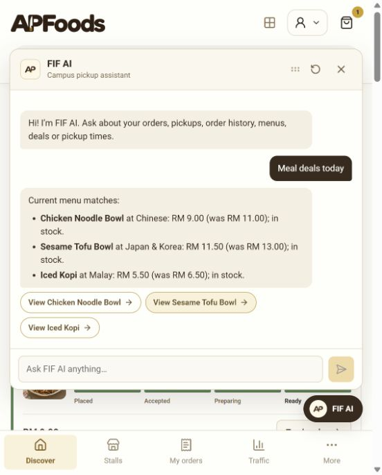
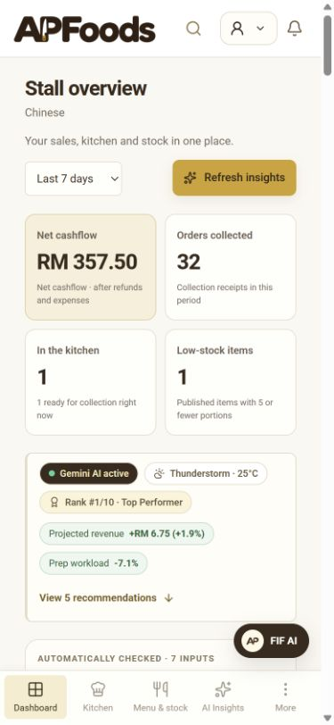
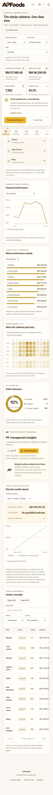

# AP Food + FIF AI

<div align="center">
  
  <p><strong>Smart Campus Food-Court Pickup Platform & AI Intelligence Suite</strong></p>
  <p>
    Built with <strong>Next.js</strong>, <strong>Capacitor</strong>, <strong>Supabase</strong>, and <strong>Google Gemini</strong>.
  </p>
</div>

---

## Overview

**AP Food** is a production-grade campus food-court ordering and kitchen-management ecosystem designed for Asia Pacific University (APU). It eliminates long cafeteria rush queues through pre-ordering, scheduled pickup windows, synchronized multi-stall carts, and **FIF AI** (*Food Intelligence Framework*) — an intelligent copilot suite tailored for students, food-stall vendors, and cafeteria administrators.

The project features two seamlessly unified experiences:
1. **The Web Platform**: A responsive web portal hosting the student storefront alongside the high-throughput **Vendor Kitchen Board** and the **Administrator Command Centre**.
2. **The Standalone Android Mobile App**: A native Capacitor Android APK designed exclusively for students to quickly order lunch, track live pickup stages, and converse with FIF AI on the go.

---

## Key Features

### 🛒 1. Student Campus Marketplace & Multi-Stall Cart
- **Cross-Stall Ordering**: Add a chicken noodle bowl from the Chinese counter and an iced kopi from the Malay counter into a single checkout flow.
- **Scheduled Pickups**: Reserve meals ahead with selectable pickup time slots matched to lecture breaks.
- **Live Order Tracking**: Visual 4-stage tracking (*Placed &rarr; Accepted &rarr; Preparing &rarr; Ready*) with an 8-digit pickup code and QR validation.
- **Smart Queue & Traffic Insights**: Real-time traffic heatmaps and wait forecasts so students avoid peak queues.

### 🤖 2. FIF AI (Food Intelligence Framework)
- **Student Assistant**: Conversational AI inside the mobile app and web to find budget deals, query order statuses (*"Where is my order?"*), and suggest low-queue meals.
- **Vendor Copilot**: Proposes inventory adjustments, menu price optimizations, and prep timing based on live order velocity and historical demand.
- **Admin Strategic Insights**: Recommends cafeteria-wide operational fixes with bound financial models and verifiable evidence snapshots.

### 🍳 3. Vendor Kitchen Board & Operations
- **Live Bump Bar**: Real-time order dispatch board for kitchen staff with audible alerts and one-tap stage progression.
- **Stock & Menu Control**: Instant 86-ing (marking sold out), portion limits, and prep-time calibration.
- **Sales & Rush Hour Analytics**: Transparent cashflow breakdown and hourly pickup distribution charts.

### 📊 4. Cafeteria Administrator Command Centre
- **Financial Desk**: Campus-wide cashflow bridge, collections audit, and settlement reporting.
- **Audit & Export**: Full PDF and CSV report generators with formula protection.
- **Stall Oversight**: Performance benchmarking, tenant health metrics, and campus traffic forecasting.

---

## Web vs Mobile App (Side-by-Side)

### 1. Student Marketplace & Food Discovery
Students browse active counters, search by cuisine, and access meal deals.

| Web Application (Desktop) | Mobile Android App (Standalone APK) |
| :---: | :---: |
|  |  |

---

### 2. FIF AI Campus Assistant
Conversational assistant providing instant answers, budget meal discovery, and live order tracking.

| Web FIF AI Assistant | Mobile App FIF AI Assistant |
| :---: | :---: |
|  |  |

---

### 3. Vendor Kitchen & Operations Board
Kitchen staff track upcoming orders, manage active menu stock, and review AI inventory recommendations.

| Web Vendor Operations Board | Mobile Vendor Overview |
| :---: | :---: |
|  |  |

---

### 4. Cafeteria Administrator Command Centre
Cafeteria management monitors campus cashflow, collection rates, vendor compliance, and rush traffic.

| Web Command Centre | Mobile Responsive View |
| :---: | :---: |
|  |  |

---

## Demo Credentials

All test accounts share the unified password: **`APFoods123!`**

> [!NOTE]
> The **Android Mobile App** is dedicated exclusively to the student experience (`student@apfoods.local`). Vendor and Administrator workspaces are optimized for desktop displays and should be accessed via a web browser.

| Role | Email | Password | Intended Portal | Capabilities |
| :--- | :--- | :--- | :--- | :--- |
| **Student** | `student@apfoods.local` | `APFoods123!` | Mobile App / `/app` | Marketplace, Multi-stall cart, Scheduled pickups, Student FIF AI |
| **Chinese Stall** | `chinese@apfoods.local` | `APFoods123!` | Web `/vendor` | Kitchen bump bar, Noodle bar menu, Stock & Copilot |
| **Malay Stall** | `malay@apfoods.local` | `APFoods123!` | Web `/vendor` | Brew & Bites kitchen, Drinks & snacks stock |
| **Japan & Korea** | `japanese@apfoods.local` | `APFoods123!` | Web `/vendor` | Green Bowl Kitchen orders, Bowls & Bento prep |
| **Indian Stall** | `indian@apfoods.local` | `APFoods123!` | Web `/vendor` | Indian counter kitchen board & dish availability |
| **Arab Shawarma** | `shawarma@apfoods.local` | `APFoods123!` | Web `/vendor` | Shawarma & wrap live preparation queue |
| **Administrator** | `admin@apfoods.local` | `APFoods123!` | Web `/admin` | Campus command centre, Financial audits, Traffic & PDF exports |

---

## Installation & Setup Guide

### Option A: Running the Web Application Locally

#### Prerequisites
- **Node.js**: v22.0.0 or higher
- **npm**: v10.0.0 or higher

#### 1. Clone the repository
```bash
git clone https://github.com/cloudywalnut/APFood.git
cd APFood
```

#### 2. Install dependencies
```bash
npm ci
```

#### 3. Environment configuration
Copy the example environment file:
```bash
# On Linux/macOS
cp .env.example .env.local

# On Windows PowerShell
Copy-Item .env.example .env.local
```

Configure your `.env.local` with the Supabase and Gemini credentials:
```env
NEXT_PUBLIC_SUPABASE_URL="https://<your-project>.supabase.co"
NEXT_PUBLIC_SUPABASE_PUBLISHABLE_KEY="<your-publishable-key>"
SUPABASE_SECRET_KEY="<your-secret-key>"
GEMINI_API_KEY="<your-gemini-api-key>"
```

#### 4. Run the development server
```bash
npm run dev
```
Open [http://localhost:3000](http://localhost:3000) in your browser.

---

### Option B: Building & Running the Android Mobile App

The native Android project is scaffolded using **Capacitor 8** in the `android/` directory and points directly to the live production deployment.

#### Prerequisites
- **Android Studio** (Koala / Ladybug or newer)
- **Android SDK & Build-Tools** (API 34 / 35)
- **Java JDK**: JDK 17 or JDK 21

#### 1. Build the Debug APK via Gradle
From the project root:
```bash
cd android
./gradlew assembleDebug
```
On Windows PowerShell:
```powershell
cd android
.\gradlew.bat assembleDebug
```

The compiled APK will be output at:
```
android/app/build/outputs/apk/debug/app-debug.apk
```

#### 2. Install and Run on an Emulator or Physical Device
Ensure ADB is connected to your device (`adb devices`):
```bash
adb install -r android/app/build/outputs/apk/debug/app-debug.apk
adb shell am start -n my.conceptsquad.apfood/.MainActivity
```

#### 3. Open in Android Studio (Optional)
To inspect layouts, configure release keystores, or run from the IDE:
```bash
npx cap open android
```

---

## Quality Checks & Testing

The project maintains comprehensive end-to-end and unit test suites:

| Command | Purpose |
| :--- | :--- |
| `npm run typecheck` | Strict TypeScript compilation & route type generation check |
| `npm test` | Unit tests for order state machine, analytics reconciliation, and FIF AI logic |
| `npm run test:backend` | Real SQL migration verification in embedded Postgres (policies, RPCs, transactions) |
| `npm run build` | Full production Next.js build verification |
| `npm run format:check` | Prettier code style verification |

---

## Project Structure

```
APFood/
├── android/                   # Standalone Capacitor native Android Studio project
│   ├── app/build/outputs/apk/ # Generated .apk binaries
│   └── app/src/main/          # Native Android manifests, icons, and themes
├── app/                       # Next.js App Router pages & API handlers
│   ├── [[...segments]]/       # Dynamic workspace router (/app, /vendor, /admin)
│   └── api/                   # Serverless routes for orders, FIF AI & analytics
├── components/                # React UI components
│   ├── storefront/            # Student marketplace, cart & student FIF AI
│   ├── workspace/             # Student, Vendor & Admin workspace shells
│   └── hosted/                # Kitchen bump bar, charts & scenario studios
├── docs/                      # Technical documentation & screenshots
│   └── screenshots/           # Side-by-side web & mobile visual assets
├── lib/                       # Domain logic, Supabase client, and AI runtimes
│   ├── backend/               # Server-side contracts, RPCs & FIF AI engine
│   ├── native-mobile.ts       # Capacitor native runtime detector
│   └── orders.ts              # Order stage validation & pricing helpers
├── public/                    # Static assets, fonts, brand logos & menus
├── supabase/                  # Database migrations, seed data & RLS policies
└── capacitor.config.ts        # Capacitor mobile app configuration
```

---

<div align="center">
  <small>&copy; 2026 AP Food & ConceptSquad. All rights reserved.</small>
</div>
